# NFT Marketplace dApp

A full-stack Ethereum marketplace for ERC-721 collectibles. Creators mint an item (image and metadata pinned to IPFS) and list it at a fixed price. Collectors buy it straight from their wallet and can resell it later. A separate ledger contract records wallet-to-wallet transfers with an attached note.

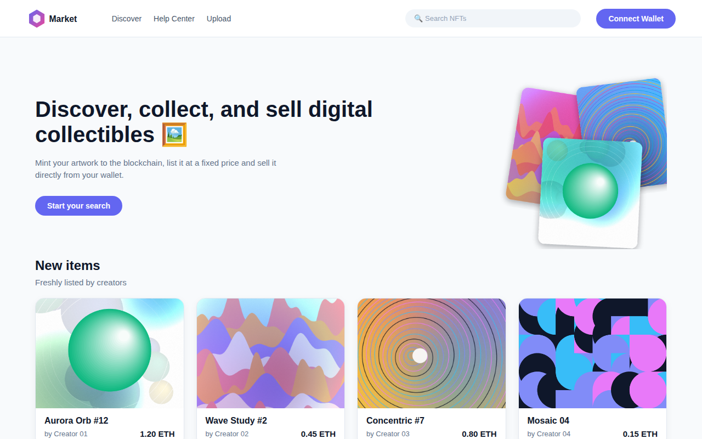

---

## Features

- **Mint and list in one transaction:** upload an image, add a name, price and description, and the app pins everything to IPFS, mints an ERC-721 token and escrows it in the marketplace.
- **Buy with a wallet:** pay the asking price; the contract pays the seller, forwards the listing fee to the operator and transfers the token.
- **Resell:** owners can re-list any token they bought at a new price.
- **Browse without a wallet:** the home and search pages read listings over a plain JSON-RPC connection.
- **Search:** filter listed items by name.
- **Profile:** see the items you have listed and the items you own.
- **Transfer ledger:** send ETH with a message and keep an on-chain history of transfers.
- **Wallet connection:** browser wallets via Web3Modal.
- **Info pages:** about, contact, subscription, account, login and sign-up layouts.

## Screens

| Home | Search |
|---|---|
|  | 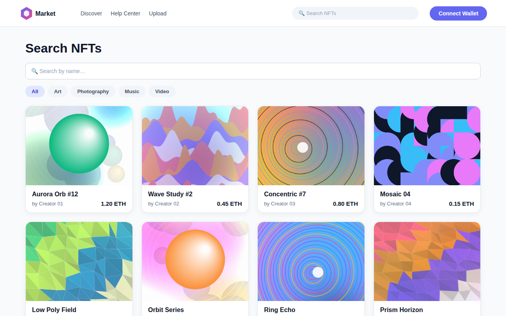 |

| Item details | Create item |
|---|---|
| 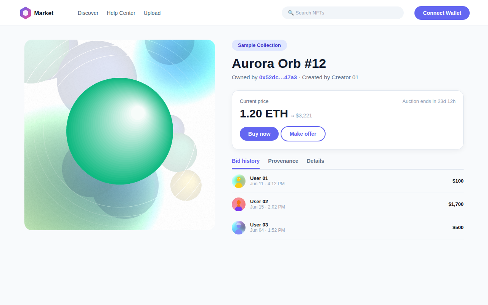 | 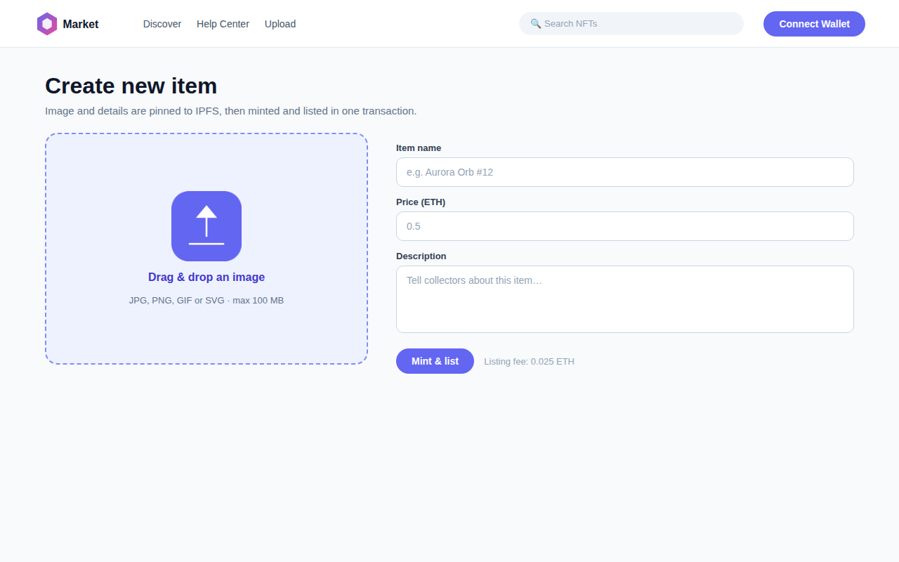 |

| Profile | Transfer funds |
|---|---|
| 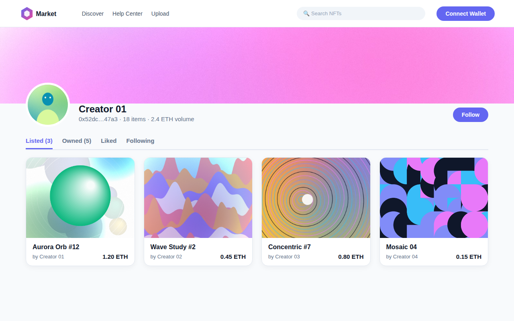 | 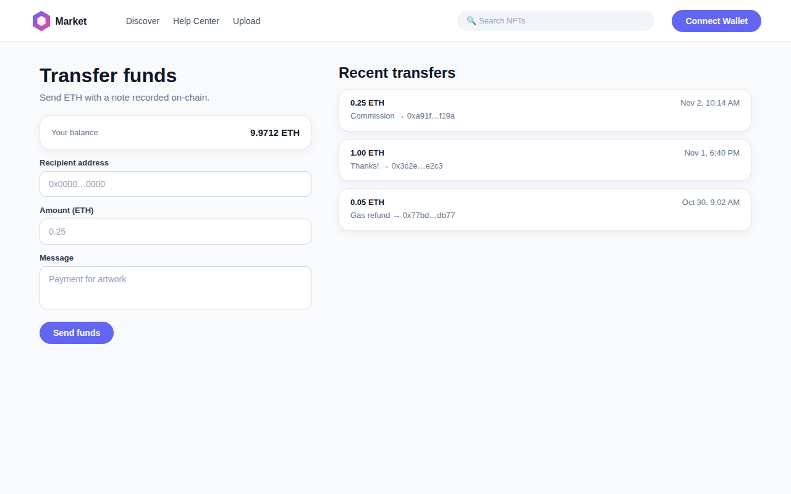 |

| Connect wallet |
|---|
| 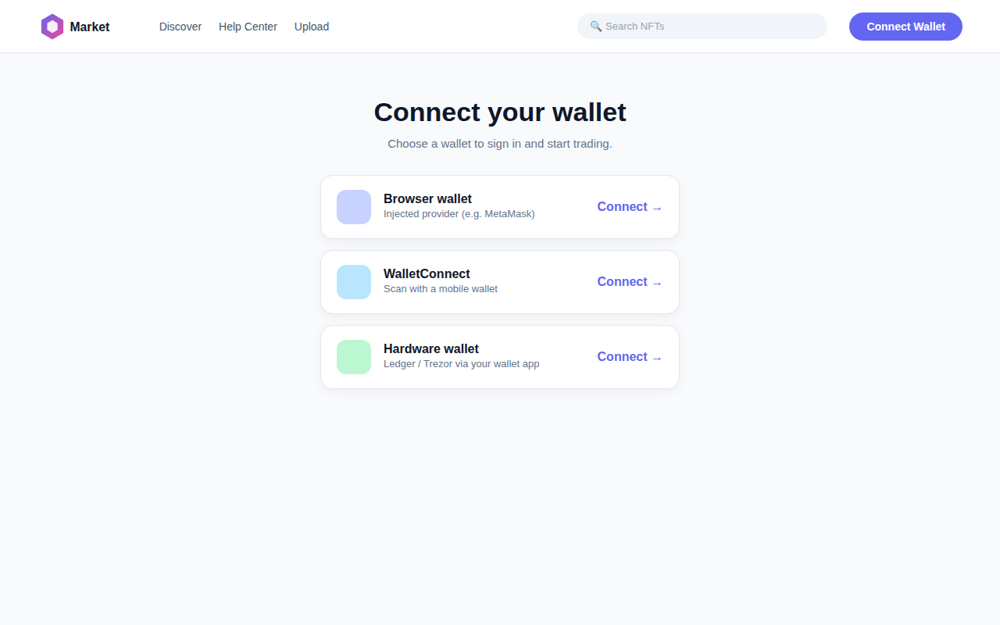 |

## Tech stack

| Layer | Tools |
|---|---|
| Frontend | Next.js 12, React 18, framer-motion, react-icons, react-dropzone |
| Web3 | ethers v5, Web3Modal |
| Smart contracts | Solidity 0.8.17, OpenZeppelin Contracts 4.x, Hardhat |
| Storage | IPFS (any pinning service that exposes the IPFS HTTP API) |
| Testing | Hardhat, Chai, ethers |

## Architecture

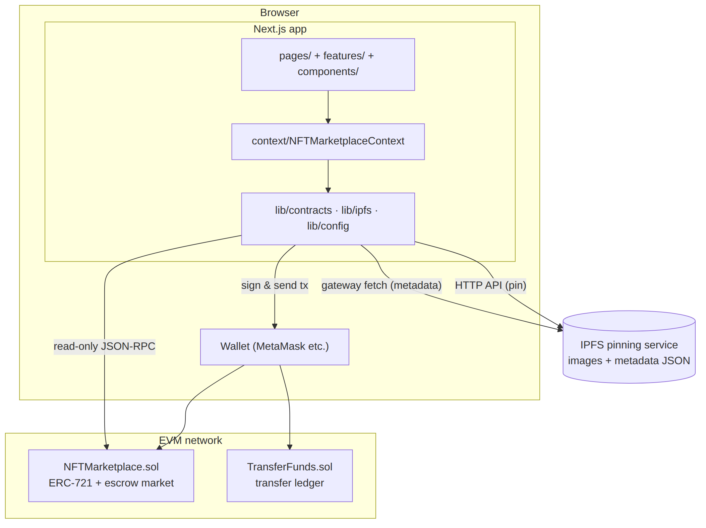

The React UI talks only to a context provider, which delegates to three small modules in `lib/`:

- `lib/config.js` reads every runtime setting from `NEXT_PUBLIC_*` environment variables
- `lib/contracts.js` builds contract instances (read-only through a JSON-RPC provider, or signing through the connected wallet) and turns raw on-chain items into UI objects
- `lib/ipfs.js` pins files and JSON and returns gateway URLs

### Listing and buying

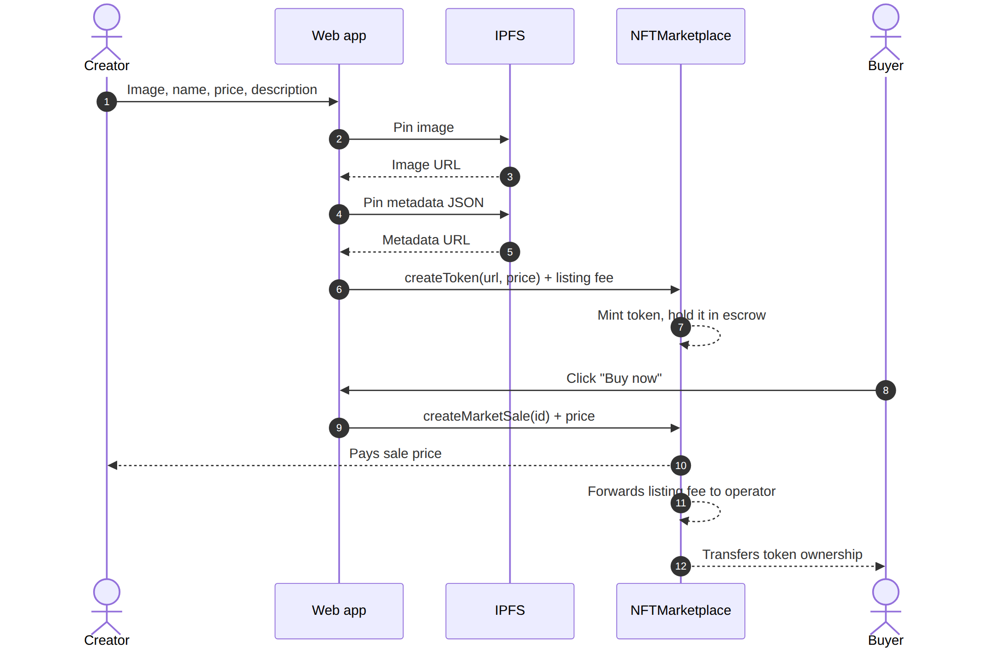

### Item lifecycle

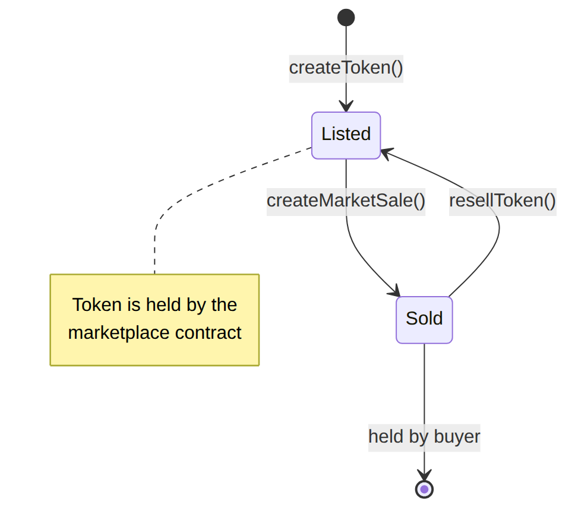

### Page map

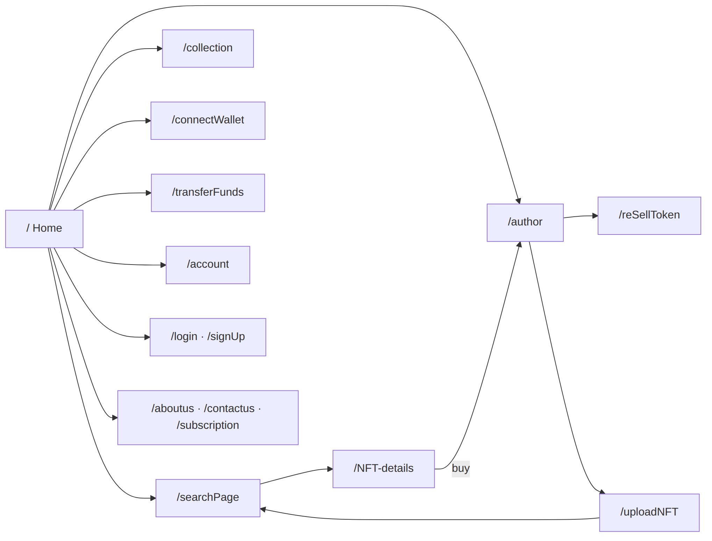

## Smart contract reference

### `NFTMarketplace`

ERC-721 token (`Marketplace Token`, `MKT`) with an escrow-style fixed-price market. A flat **listing fee** (default `0.025 ETH`) is paid on every listing and is forwarded to the operator when the item sells

| Function | Who | Description |
|---|---|---|
| `createToken(tokenURI, price)` | anyone, payable | Mints a token and lists it. Must send exactly the listing fee. |
| `createMarketSale(tokenId)` | anyone, payable | Buys a listed item. Must send exactly the asking price. |
| `resellToken(tokenId, price)` | current owner, payable | Re-lists an owned token. Must send exactly the listing fee. |
| `fetchMarketItems()` | view | Items currently for sale. |
| `fetchMyNFTs()` | view | Items owned by the caller. |
| `fetchItemsListed()` | view | Items the caller has listed. |
| `getListingPrice()` | view | Current listing fee in wei. |
| `updateListingPrice(fee)` | operator only | Changes the listing fee. |

Events: `MarketItemCreated(tokenId, seller, owner, price, sold)`

Safety properties: state is updated before any ETH is sent, payouts use `call` with a success check, and `createMarketSale` is protected by a reentrancy guard

### `TransferFunds`

Records transfers made from a wallet together with a message. The ETH itself moves in a normal wallet transaction; this contract only stores the record.

| Function | Description |
|---|---|
| `addDataToBlockchain(receiver, amount, message)` | Stores a record and emits `TransferEvent`. |
| `getAllTransactions()` | Returns every stored record. |
| `getTransactionCount()` | Returns the number of records. |

### `DutchAuction` (standalone example)

A declining-price auction for a single ERC-721 token. It is not connected to the UI.The seller must approve the contract for the token before buyers can call `buy()`

## Project structure

```
.
├── contracts/            NFTMarketplace, TransferFunds, DutchAuction
├── scripts/deploy.js     deploys contracts and writes deployments/<network>.json
├── test/                 Hardhat tests for the marketplace
├── context/              React context + contract ABIs
├── lib/                  config, IPFS client, contract helpers
├── pages/                Next.js routes
├── features/             page-level modules
│   ├── account/  auth/  author/  collection/
│   ├── nft-details/  search/  subscription/
│   └── top-creators/  upload/
├── components/           shared UI (NavBar, Footer, NFTCard, Slider, ...)
├── data/                 sample JSON for demo sections
├── assets/img/           generated artwork, icons and sample audio
├── styles/               global and page CSS modules
├── docs/                 screenshots and diagram sources
├── hardhat.config.js
└── next.config.js
```

## Getting started

### Prerequisites

- Node.js 16 or newer and npm
- A browser wallet such as MetaMask
- An IPFS pinning service account (only needed to upload new items)

### Install and run locally

```bash
# 1. Install dependencies
npm install

# 2. Create your environment file
cp .env.example .env.local

# 3. Start a local blockchain (terminal 1)
npx hardhat node

# 4. Deploy the contracts to it (terminal 2)
npm run deploy:local

# 5. Start the web app (terminal 2)
npm run dev
```

Open <http://localhost:3000>.

In your wallet, add the local network (RPC `http://127.0.0.1:8545`, chain ID `31337`) and import one of the private keys that `npx hardhat node` prints. These keys are public test keys; never use them on a real network

If the addresses printed by the deploy step differ from the defaults in `.env.example`, update `NEXT_PUBLIC_MARKETPLACE_ADDRESS` and `NEXT_PUBLIC_TRANSFER_ADDRESS` and restart the dev server

### Available scripts

| Script | What it does |
|---|---|
| `npm run dev` | Start the Next.js dev server |
| `npm run build` / `npm start` | Production build and server |
| `npm run node` | Start a local Hardhat chain |
| `npm run compile` | Compile contracts |
| `npm test` | Run the contract tests |
| `npm run deploy:local` | Deploy to the local chain |
| `npm run deploy:testnet` | Deploy to the network named `testnet` |

## Configuration

Copy `.env.example` to `.env.local` (frontend) and `.env` (Hardhat deployment). Never commit either file.

| Variable | Used by | Purpose |
|---|---|---|
| `NEXT_PUBLIC_MARKETPLACE_ADDRESS` | frontend | Deployed `NFTMarketplace` address |
| `NEXT_PUBLIC_TRANSFER_ADDRESS` | frontend | Deployed `TransferFunds` address |
| `NEXT_PUBLIC_RPC_URL` | frontend | Read-only RPC used to browse without a wallet |
| `NEXT_PUBLIC_IPFS_API_HOST` | frontend | Host of the IPFS HTTP API |
| `NEXT_PUBLIC_IPFS_PROJECT_ID` / `NEXT_PUBLIC_IPFS_PROJECT_SECRET` | frontend | Pinning service credentials (optional for open nodes) |
| `NEXT_PUBLIC_IPFS_GATEWAY` | frontend | Public gateway used to build image and metadata URLs |
| `TESTNET_RPC_URL` | Hardhat | RPC endpoint for the testnet |
| `DEPLOYER_PRIVATE_KEY` | Hardhat | Account that deploys the contracts |

## Usage guide

**Connect.** Click **Connect Wallet** and approve the connection. The navigation bar shows your account once connected

**Create an item.** Open **Upload**, drop an image, fill in the name, price (in ETH) and description, then click **Mint & list**. Confirm the transaction in your wallet. You pay the listing fee plus gas. When it confirms you are redirected to the search page

**Buy an item.** Open an item from the home or search page and click **Buy now**. After confirmation the item appears under **Owned** on your profile

**Resell.** On your profile, choose an owned item, set a new price and confirm. The token returns to escrow and shows on the marketplace again

**Transfer funds.** Open **Transfer funds**, enter a recipient, amount and message. Two wallet confirmations are requested: the ETH transfer, then the on-chain record

## Testing

```bash
npm test
```

The tests cover listing and escrow, fee and price validation, payouts to seller and operator, double-purchase and underpayment rejection, reselling with the owner and seller views, and operator-only fee updates

## Deploying to a testnet

1. Fund a throwaway account with test ETH
2. In `.env`, set `TESTNET_RPC_URL` and `DEPLOYER_PRIVATE_KEY`
3. Run `npm run deploy:testnet`. Addresses are saved to `deployments/testnet.json`
4. Copy them into `NEXT_PUBLIC_MARKETPLACE_ADDRESS` and `NEXT_PUBLIC_TRANSFER_ADDRESS`, and set `NEXT_PUBLIC_RPC_URL` to the testnet RPC
5. Point your wallet at the same network

## Troubleshooting

| Symptom | Likely cause and fix |
|---|---|
| Home page shows no items | The contract address or `NEXT_PUBLIC_RPC_URL` is wrong, or nothing is listed yet. Check the browser console. |
| "Uploading to IPFS failed" | `NEXT_PUBLIC_IPFS_*` variables are missing or the credentials are invalid. |
| "Please install a browser wallet" | No injected wallet was found in the browser. |
| Transactions fail with "Send exactly the listing fee" | The listing fee changed. The app reads it from the contract, so reload and retry. |
| Wallet shows the wrong network | Switch the wallet to the network where you deployed. Local chain ID is `31337`. |
| Images do not load | Add the gateway host via `NEXT_PUBLIC_IPFS_GATEWAY` and restart `npm run dev` (it feeds `next.config.js`). |
| Nonce errors after restarting the local node | Reset the account in the wallet's advanced settings. |

## Security notes

- Never commit `.env` files or private keys
- Variables prefixed `NEXT_PUBLIC_` are bundled into browser code. For production, send IPFS uploads through your own server route so pinning credentials are never exposed
- The contracts have not been audited. Use testnets, or get a professional audit before handling real funds
- Treat metadata fetched from IPFS as untrusted input

## Roadmap

- Auctions in the UI, using `DutchAuction` as a starting point
- Marketplace events and indexing instead of scanning arrays on-chain
- Pagination for large listings
- Server-side IPFS upload endpoint
- Royalty support for creators
- End-to-end tests with a wallet emulator

## Contributing

1. Fork the repository and create a feature branch
2. Run `npm test` before opening a pull request
3. Keep changes focused and describe what you tested

---
